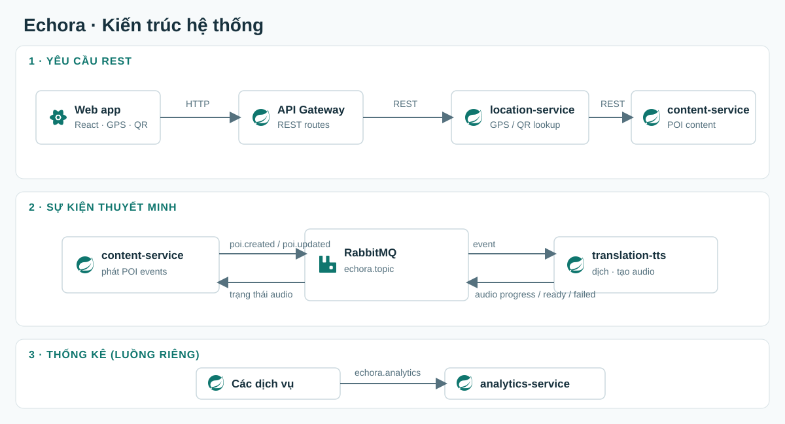
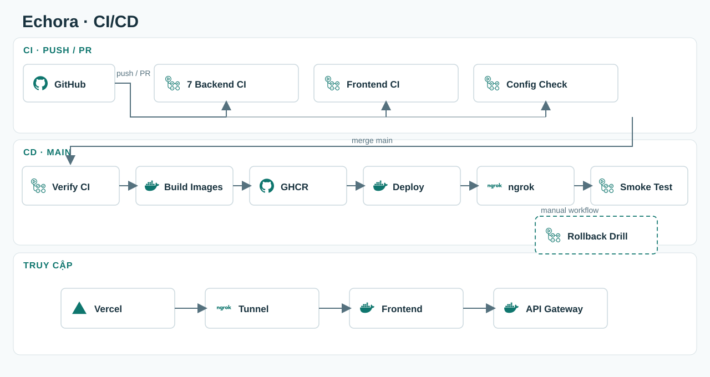

# Echora

## 1. Giới thiệu

Echora là đồ án nhóm của học phần Software Engineering tại Saigon University, được lưu trong repo [Nhom3_CNPM](https://github.com/congtinh06/Nhom3_CNPM). Ứng dụng giúp du khách tìm hiểu các điểm tham quan phổ biến ở Thành phố Hồ Chí Minh qua bản đồ, vị trí GPS, mã QR và nội dung thuyết minh âm thanh nhiều ngôn ngữ. Hệ thống có thêm chức năng quản lý tài khoản, quyền nghe, sản phẩm địa phương và đơn hàng. [Bản demo](https://nhom3-cnpm.vercel.app) chỉ hoạt động khi máy deploy và tunnel ngrok đang chạy.

## 2. Kiến trúc và luồng xử lý

Yêu cầu từ giao diện đi qua API Gateway đến các dịch vụ vị trí và nội dung; location-service gọi content-service qua REST để phân giải vị trí hoặc mã QR. Khi POI được tạo hay cập nhật, content-service phát event qua RabbitMQ exchange echora.topic để translation-tts-service dịch và tạo audio; dịch vụ này gửi event trạng thái về content-service. Analytics nhận và xử lý event qua luồng RabbitMQ riêng.

Các cổng dưới đây là cổng bên trong mạng Docker; Compose mặc định chỉ publish API Gateway và frontend ra máy host.

| Service | Vai trò | Cổng nội bộ |
|---|---|---:|
| api-gateway | Định tuyến API | 8080 |
| auth-service | Tài khoản và xác thực | 8086 |
| content-service | Điểm tham quan và nội dung | 8085 |
| location-service | GPS, lân cận và QR | 8082 |
| translation-tts-service | Bản dịch và audio | 8083 |
| analytics-service | Nhận event thống kê | 8081 |
| order-service | Đơn hàng và quyền nghe | 8087 |

Các routing key của luồng nội dung/audio gồm poi.created, poi.updated, poi.audio.progress, poi.audio.ready và poi.audio.failed. Các queue tương ứng là poi.created.queue, poi.updated.queue, poi.audio.progress.queue, poi.audio.ready.queue và poi.audio.failed.queue. Analytics dùng exchange echora.analytics, routing key analytics.event và queue analytics.event.queue. Các queue lỗi được chuyển qua dead-letter exchange.

## 3. Công nghệ

| Thành phần | Công nghệ |
|---|---|
| Giao diện | React, TypeScript, Vite, Leaflet |
| Backend services | Java 17, Spring Boot 3.3.4 |
| API Gateway | Spring Cloud Gateway |
| Giao tiếp nội bộ | REST, OpenFeign, RabbitMQ |
| Cơ sở dữ liệu | Microsoft SQL Server 2022, năm database nghiệp vụ |
| Đóng gói và phục vụ giao diện | Docker Compose, Nginx |
| CI/CD | GitHub Actions, GitHub Container Registry (GHCR), runner tự host |
| Demo web | Vercel, cấu hình chuyển tiếp API qua tunnel ngrok |

## 4. Cài đặt và chạy

### Yêu cầu

- Docker Desktop hoặc Docker Engine có Docker Compose v2.
- Node.js 20 để tạo cấu hình và chạy script kiểm tra môi trường.

### Khởi động toàn bộ hệ thống

Chạy các lệnh sau từ thư mục gốc:

~~~sh
node scripts/setup-env.mjs
node scripts/check-env.mjs
docker compose up -d --build
docker compose ps
~~~

Script setup-env tạo file .env và frontend/.env nếu chưa có, sinh các secret cục bộ và không in giá trị secret ra màn hình. Giữ các file này ở máy chạy; không đưa chúng lên Git. Compose khởi tạo SQL Server, RabbitMQ, các backend service, API Gateway và frontend.

### Cổng truy cập

| Thành phần | Địa chỉ máy host mặc định | Bind |
|---|---|---|
| Giao diện | http://localhost:8088 | 0.0.0.0 |
| API Gateway | http://localhost:18080 | 127.0.0.1 |
| SQL Server | localhost:1401 | 127.0.0.1 |
| RabbitMQ AMQP | localhost:5672 | 127.0.0.1 |
| RabbitMQ Management | http://localhost:15800 | 127.0.0.1 |

Đã chạy Docker Compose config với .env.example và giá trị kiểm tra tạm thời cho các biến bắt buộc để tránh đọc .env. Kết quả của service frontend là host_ip 0.0.0.0, published 8088, target 8080, protocol tcp.

### Cấu hình dev và thanh toán

Để gọi trực tiếp từng backend từ máy phát triển, chạy:

~~~sh
docker compose -f docker-compose.yml -f docker-compose.dev.yml up -d --build
~~~

> **Chỉ dùng docker-compose.dev.yml ở máy local.** Overlay này publish các cổng backend trên mọi network interface và bật payment mock. Không dùng overlay này khi deploy.

VNPAY và VietQR đã được triển khai trong mã nguồn nhưng cần cấu hình; thanh toán end-to-end chưa được xác minh. Mock thanh toán tắt theo mặc định trong docker-compose.yml và được bật trong docker-compose.dev.yml. VNPAY cần cấu hình merchant và thông tin ký từ nhà cung cấp; cấu hình sandbox chưa được xác minh. VietQR có luồng xác nhận demo và xác nhận thủ công từ admin; không mô tả đây là xác nhận giao dịch tự động.

Trong cấu hình demo, frontend/vercel.json đang ghi trực tiếp URL tunnel cho các route API và ảnh sản phẩm. scripts/start-demo.ps1 hướng dẫn cập nhật URL trong file này và có thể đã cũ. README không đưa URL tunnel cụ thể.

## 5. CI/CD

| Bước | Việc thực hiện | Workflow hoặc file |
|---|---|---|
| 7 backend CI | Chạy Maven test và build Docker image để kiểm tra; không push image | auth-service.yml, content-service.yml, location-service.yml, translation-tts-service.yml, analytics-service.yml, order-service.yml, api-gateway.yml |
| Frontend CI | Lint, test, kiểm tra route SPA, build và smoke test bản preview | frontend-ci.yml |
| Kiểm tra cấu hình | Kiểm tra .env.example, bootstrap và cấu hình Docker Compose | config-check.yml |
| Build và publish | Khi push lên main, xác minh CI liên quan, build tám image và publish tag latest cùng tag theo commit lên GHCR | cd.yml |
| Deploy | Runner tự host đồng bộ checkout, pull image, cập nhật Compose, kiểm tra health, đảm bảo tunnel và chạy smoke test URL công khai | cd.yml, scripts/deploy/deploy-local.sh, scripts/deploy/ensure-ngrok-tunnel.ps1 |
| Kiểm tra rollback | Workflow thủ công để thử rollback khi tag image không tồn tại | cd-rollback-drill.yml, scripts/deploy/deploy-local.sh |
| Phục vụ demo web | Build frontend bằng Vite; cấu hình route SPA và chuyển tiếp API/ảnh sản phẩm qua tunnel | frontend/vercel.json |

Các workflow CI chạy theo push hoặc pull request trên những nhánh và đường dẫn được khai báo trong từng workflow. CD chạy khi push lên main; tag v* cũng kích hoạt build và publish image nhưng không chạy job deploy. Deploy cần runner tự host có nhãn echora cùng cấu hình môi trường deploy.

## 6. Cấu trúc thư mục

~~~text
.
├── backend/                 # API Gateway và sáu backend service
├── docker/                  # Script khởi tạo cơ sở dữ liệu
├── docs/
│   └── images/              # Sơ đồ dùng trong tài liệu
├── frontend/                # Giao diện React
├── scripts/                 # Bootstrap, kiểm tra cấu hình và deploy
├── .github/workflows/       # CI, CD và kiểm tra cấu hình
├── docker-compose.yml       # Stack chạy mặc định
├── docker-compose.dev.yml   # Overlay dành cho phát triển local
└── docker-compose.deploy.yml # Overlay dùng image GHCR khi deploy
~~~

## 7. Nhóm thực hiện

| STT | Họ và tên | MSSV | Công việc | Đóng góp |
|---:|---|---:|---|---:|
| 1 | Dang Huu Dang Tam | 3124411265 | TODO | TODO |
| 2 | Dang Dao Dat Thanh | 3124411274 | TODO | TODO |
| 3 | Huynh Cong Tinh | 3124411315 | TODO | TODO |
