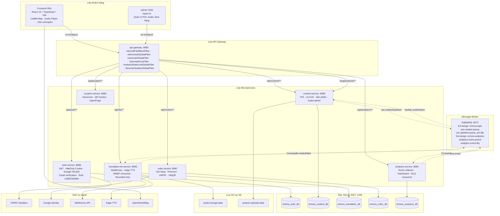
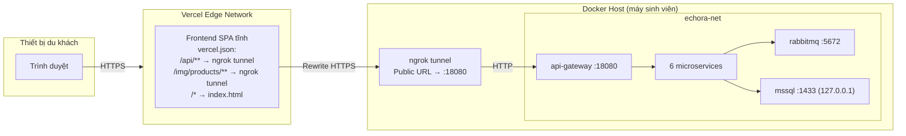
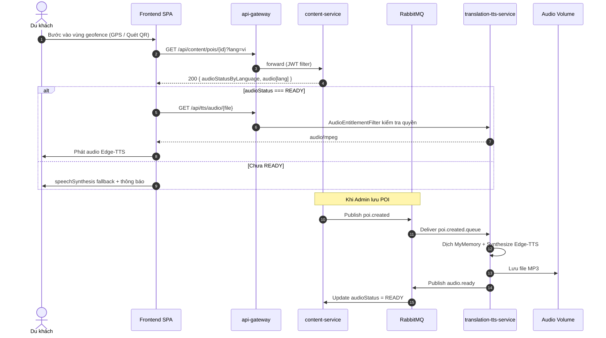
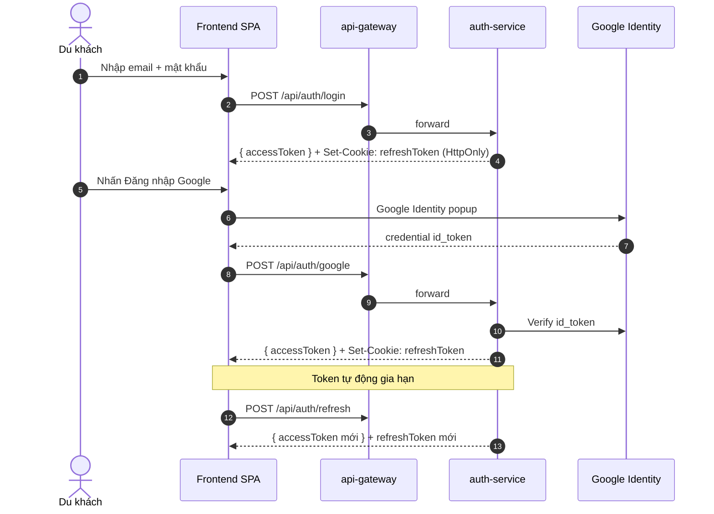
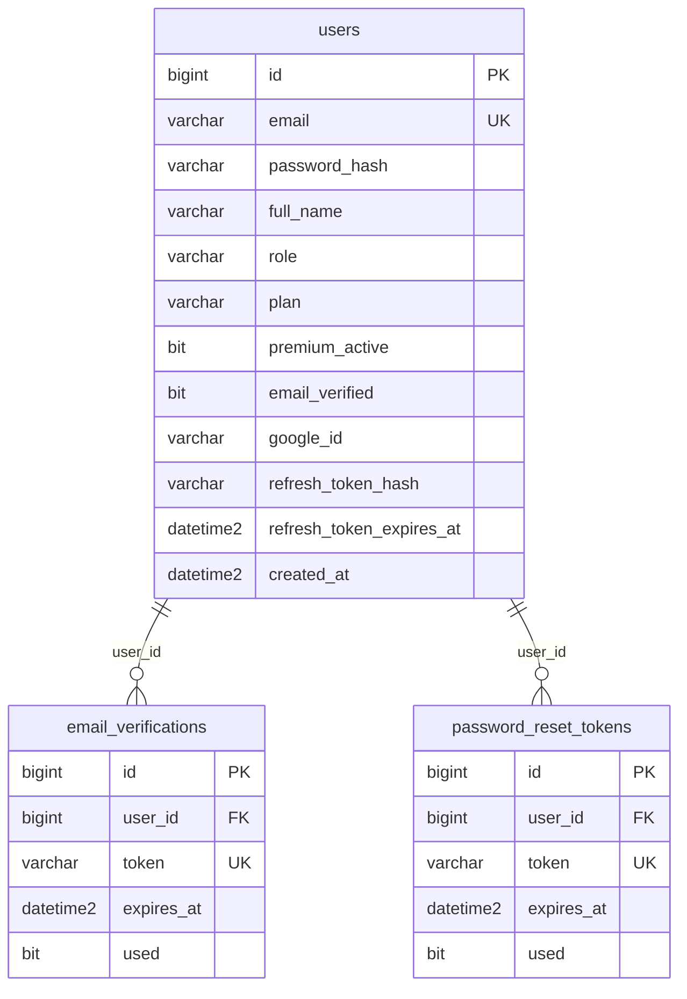
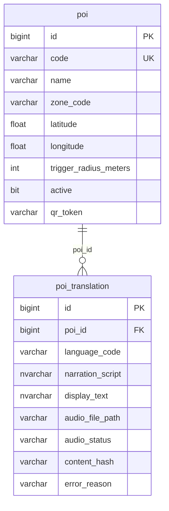
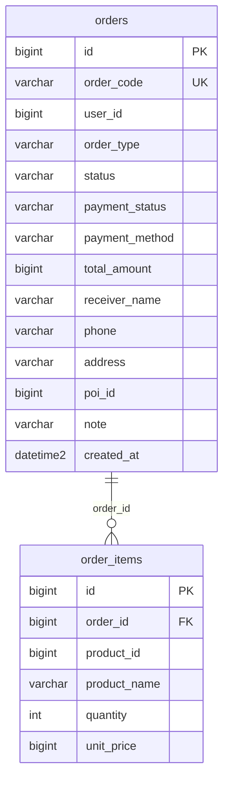
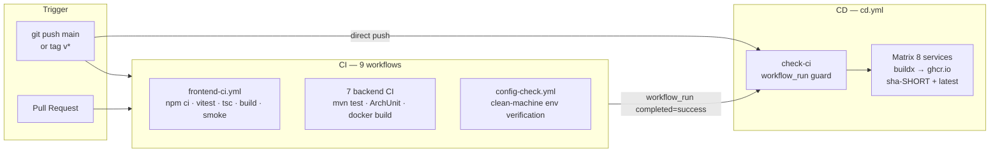

# Tài liệu Kiến trúc Echora

Tài liệu này mô tả kiến trúc kỹ thuật của nền tảng **Echora** — hướng dẫn viên du lịch số đa ngôn ngữ tự động cho di sản Thành phố Hồ Chí Minh. Mọi phần tử trong các sơ đồ đều có tương ứng trong mã nguồn thực tế.

---

## 1. Sơ đồ thành phần (Component Diagram)

Nguồn: `docker-compose.yml`, `backend/api-gateway/src/main/resources/application.yml`, `frontend/src/api/client.ts`.

### 1.1. Chuỗi bộ lọc API Gateway và Hợp đồng OpenAPI gộp

**Chuỗi Bộ lọc API Gateway (Spring Cloud Gateway WebFlux):**
1. `TraceIdGlobalFilter`: Đính kèm và chuẩn hóa header `X-Trace-Id` (UUID) xuyên suốt toàn bộ vòng đời request.
2. `UntrustedHeaderStripGlobalFilter`: Loại bỏ các header đặc quyền giả mạo từ bên ngoài gửi vào (`X-User-Id`, `X-User-Role`, `X-Internal-Api-Key`).
3. `InternalPathBlockFilter`: Chặn tuyệt đối mọi request từ client cố tình truy cập vào các đường dẫn nội bộ (`/internal/**`, `/api/**/internal/**`).
4. `PathGuardFilter`: Kiểm tra và ngăn chặn các hành vi tấn công Path Traversal (`..`, `%2e%2e`).
5. `OpenApiDocsFilter`: Kiểm soát truy cập tài liệu API dựa trên biến môi trường `ECHORA_DOCS_ENABLED` (mặc định tắt trên môi trường deploy). Khi tắt, trả về HTTP 404 với chuẩn `application/problem+json` (`RFC 7807`), không làm lộ cấu trúc hệ thống.
6. `UserAuthGlobalFilter`: Xác thực JWT token từ HttpOnly Cookie `auth_token`, trích xuất thông tin người dùng và chuyển tiếp tới downstream services.
7. `AdminAuthGlobalFilter`: Kiểm tra quyền hạn `ADMIN` cho các endpoint quản trị (`/api/auth/admin/**`, `/api/admin/**`, `/api/content/admin/**`, `/api/orders/admin/**`).
8. `AnalyticsRateLimitGlobalFilter`: Áp dụng Rate Limiting bảo vệ endpoint thu thập sự kiện phân tích.
9. `SecurityHeadersGlobalFilter`: Gắn các header bảo mật HTTP nghiêm ngặt (CSP, HSTS, `X-Content-Type-Options: nosniff`, `X-Frame-Options: DENY`, `Referrer-Policy`, `Permissions-Policy`).

**Hợp đồng OpenAPI gộp (OpenAPI 3.0 / Swagger UI):**
- Gateway cung cấp Swagger UI thống nhất tại `http://localhost:18080/swagger-ui.html` cho phép xem và thử nghiệm API của toàn bộ 6 microservices thông qua menu chọn:
  - **Auth Service** (`/v3/api-docs/auth`): **30 public paths** (xác thực, đăng ký/đăng nhập, đổi mật khẩu, xác thực email, quản trị tài khoản, phiên QR Login).
  - **Content Service** (`/v3/api-docs/content`): **40 public paths** (điểm tham quan POI, lộ trình du lịch, ẩm thực & quà lưu niệm, tin tức di sản, audio admin).
  - **Location Service** (`/v3/api-docs/location`): **3 public paths** (tính khoảng cách Haversine, tìm POI lân cận theo tọa độ GPS, quét mã QR điểm đến).
  - **Translation & TTS Service** (`/v3/api-docs/translation`): **1 public path** (phát luồng âm thanh thuyết minh audio đa ngữ theo định dạng byte-range).
  - **Analytics Service** (`/v3/api-docs/analytics`): **6 public paths** (tiếp nhận sự kiện nghe thuyết minh, thống kê tương tác du khách, biểu đồ xu hướng).
  - **Order Service** (`/v3/api-docs/order`): **18 public paths** (giỏ hàng, tạo đơn hàng mua gói Premium / quà lưu niệm, thanh toán VNPAY, VietQR).
- **Tổng số public paths**: **98 endpoints** (toàn bộ endpoint nội bộ được ẩn với `@Hidden`, số endpoint `/internal` lộ ra = 0). Mọi URL máy chủ trong tài liệu đều trỏ về API Gateway (`http://localhost:18080`).

---

## 2. Sơ đồ triển khai (Deployment Diagram)

Nguồn: `frontend/vercel.json`, `docker-compose.yml`.

> URL ngrok thay đổi theo phiên. Xem `scripts/start-demo.ps1` để biết cách cập nhật. Header `ngrok-skip-browser-warning: 1` đã được thêm trong `vercel.json`.

---

## 3. Luồng thuyết minh (Narration Sequence)

Nguồn: `PoiEventPublisher.java`, `PoiAudioEventListener.java`, `PoiPipelineServiceImpl.java`, `useNearbyAudio.ts`.

---

## 4. Luồng đăng nhập / Google OAuth

Nguồn: `AuthController.java`, `JwtAuthenticationFilter.java`, `AuthContext.tsx`.

---

## 5. ERD theo database

Nguồn: Flyway migration trong `backend/*/src/main/resources/db/migration/`.

### 5.1. echora_auth_db

### 5.2. echora_content_db (bảng chính)

### 5.3. echora_order_db (bảng chính)

---

## 6. Sơ đồ CI/CD Pipeline

Nguồn: `.github/workflows/`.

---

## 7. Danh sách Use Case

Nguồn: `frontend/src/App.tsx`, `frontend/src/admin/AdminRoutes.tsx`, backend controllers.

| # | Actor | Use Case | Route / Endpoint |
|---|---|---|---|
| UC-01 | Khách | Xem bản đồ và danh sách điểm đến | `/diem-du-lich` |
| UC-02 | Khách | Nghe thuyết minh tự động khi gần POI | GPS geofence → audio |
| UC-03 | Khách | Quét mã QR tại điểm tham quan | `/quet-ma`, `/qr/:token` |
| UC-04 | Khách | Chọn ngôn ngữ thuyết minh | Header selector |
| UC-05 | Khách | Xem ẩm thực và quà lưu niệm | `/am-thuc`, `/am-thuc/:slug` |
| UC-06 | Người dùng | Đặt hàng và thanh toán | `/thanh-toan`, `POST /api/orders` |
| UC-07 | Người dùng | Xem lịch sử đơn hàng | `/don-hang`, `GET /api/orders` |
| UC-08 | Người dùng | Nâng cấp Premium | `/nang-cap`, `POST /api/orders/premium` |
| UC-09 | Người dùng | Đăng nhập / Đăng ký / Google OAuth | `POST /api/auth/login` |
| UC-10 | Người dùng | Đặt lại mật khẩu qua email | `POST /api/auth/reset-password` |
| UC-11 | Admin | Quản lý POI, sản phẩm, tin tức | `/quan-tri`, `/api/content/admin/**` |
| UC-12 | Admin | Xem thống kê real-time | `/quan-tri/thong-ke`, `/api/analytics/summary` |
| UC-13 | Admin | Tạo lại audio | `POST /api/content/admin/audio/regenerate` |
| UC-14 | Admin | Xem trạng thái audio | `GET /api/content/admin/audio/status` |
| UC-15 | Admin | Quản lý đơn hàng | `/api/admin/orders` |
