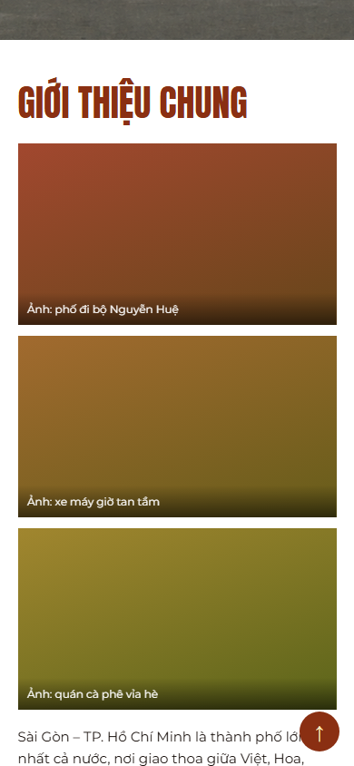
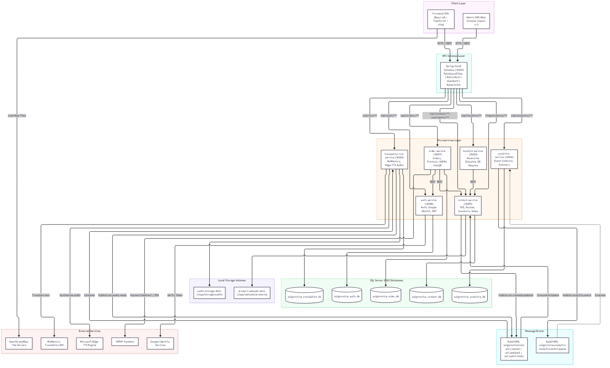
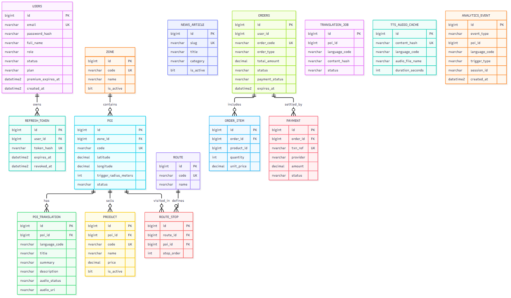
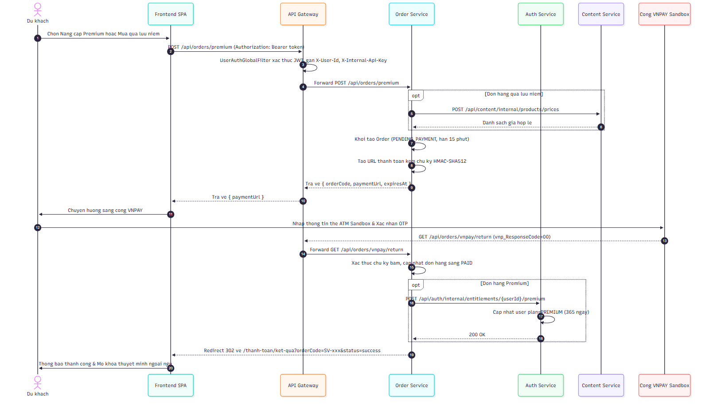
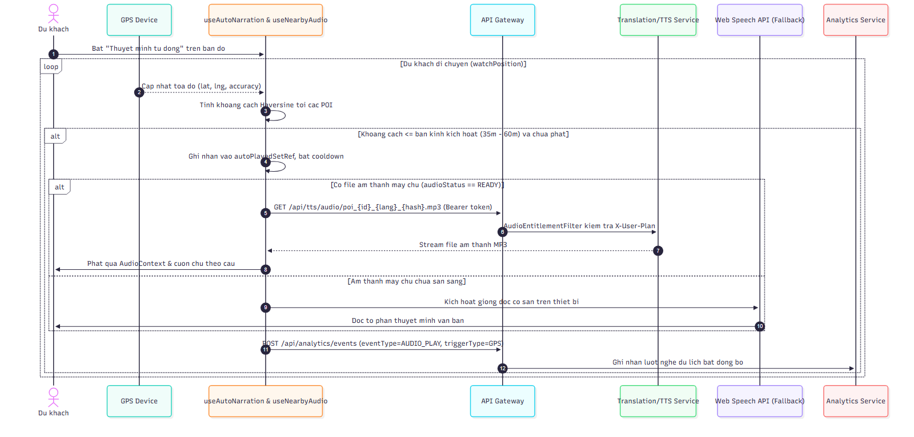
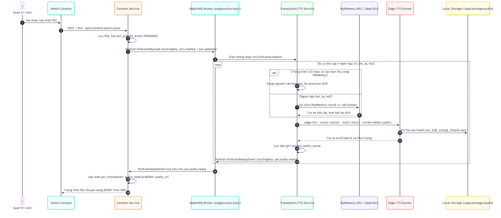
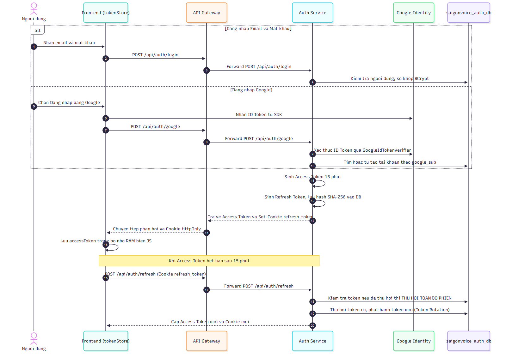

# ECHORA — NỀN TẢNG HƯỚNG DẪN VIÊN DU LỊCH ĐA NGÔN NGỮ TỰ ĐỘNG
## Tài liệu Yêu cầu Sản phẩm (Product Requirements Document - PRD)
### Dự án Kỹ thuật Phần mềm — Nhóm 3 (Echora / SaigonVoice)

---

## 1. Problem Alignment

*(Mục này được suy luận từ [README.md:15-37](file:///f:/Nhom3_CNPM/README.md#L15-L37), [PRD_Echora.md:6-13](file:///f:/Nhom3_CNPM/docs/PRD_Echora.md#L6-L13) và giao diện du khách tại [frontend/src/pages/NearbyPage.tsx:113-145](file:///f:/Nhom3_CNPM/frontend/src/pages/NearbyPage.tsx#L113-L145))*

- **Thiếu hướng dẫn viên đa ngôn ngữ cho du khách độc lập**: Du khách trong và ngoài nước khi tham quan các di tích lịch sử và văn hóa TP.HCM thường phải tự đọc bảng thông tin tĩnh hoặc phụ thuộc vào hướng dẫn viên truyền thống, thiếu trải nghiệm thuyết minh tự động bằng tiếng mẹ đẻ (`vi`, `en`, `ja`, `ko`).
- **Trải nghiệm tham quan bị phân mảnh và gián đoạn**: Du khách di chuyển ngoài thực địa khó nhận biết khi nào mình đã bước vào khu vực ảnh hưởng của điểm di tích, phải thao tác tra cứu bản đồ liên tục trên điện thoại.
- **Tín hiệu định vị không ổn định tại một số khu vực**: Tín hiệu GPS trong đô thị đông đúc hoặc bên trong các công trình di tích dễ bị suy giảm hoặc mất sóng, đòi hỏi giải pháp thay thế tức thì để không làm gián đoạn chuyến tham quan.
- **Rào cản tiếp cận sản phẩm địa phương và thanh toán**: Du khách có nhu cầu mua sắm quà lưu niệm và trải nghiệm ẩm thực đặc trưng gắn liền với từng điểm di tích nhưng thiếu kênh đặt hàng trực tuyến thuận tiện, minh bạch với cổng thanh toán bảo đảm.
- **Chi phí vận hành và cập nhật nội dung di sản cao**: Đơn vị quản lý di sản gặp khó khăn trong việc cập nhật thông tin thuyết minh đồng bộ trên nhiều ngôn ngữ, việc thu âm thủ công từng bài phát thanh tốn kém thời gian và ngân sách.

---

## 2. High Level Approach

*(Mục này được suy luận từ [README.md:39-75](file:///f:/Nhom3_CNPM/README.md#L39-L75), [docker-compose.yml:1-380](file:///f:/Nhom3_CNPM/docker-compose.yml#L1-L380) và [frontend/src/App.tsx:85-165](file:///f:/Nhom3_CNPM/frontend/src/App.tsx#L85-L165))*

- **Ứng dụng Web đơn trang (SPA) tối ưu di động**: Xây dựng trên nền tảng React 18, TypeScript và Vite, cho phép du khách truy cập tức thì qua trình duyệt web trên điện thoại (iOS Safari, Android Chrome) mà không cần cài đặt ứng dụng native từ kho ứng dụng.
- **Định vị Geofence kết hợp bản đồ Leaflet + OpenStreetMap**: Khai thác Geolocation API để định vị thời gian thực, tính toán khoảng cách tự động bằng công thức Haversine và hiển thị trực quan các điểm di tích kèm bán kính kích hoạt (40–55m).
- **Thuyết minh âm thanh tự động hai tầng (Adaptive Audio Engine)**: Ưu tiên phát file âm thanh chất lượng cao sinh bởi động cơ Microsoft Edge-TTS từ máy chủ; tự động kích hoạt cơ chế dự phòng Web Speech API của trình duyệt khi ngoại tuyến hoặc nội dung âm thanh máy chủ chưa sẵn sàng.
- **Cơ chế QR Token bổ trợ**: Cung cấp mã QR vật lý tại từng điểm dừng tham quan, cho phép kích hoạt nhanh bài thuyết minh khi thiết bị mất sóng GPS hoặc người dùng từ chối cấp quyền vị trí.
- **Thương mại điện tử quà lưu niệm & Nâng cấp Premium**: Tích hợp danh mục quà lưu niệm và phân hệ gói dịch vụ Premium mở khóa thuyết minh ngoại ngữ, thanh toán qua cổng VNPAY sandbox hoặc mã chuyển khoản VietQR tự động.
- **Kiến trúc Microservices phân tán hướng sự kiện**: Tách biệt 6 microservices backend (Auth, Content, Location, Translation/TTS, Order, Analytics) đứng sau Spring Cloud Gateway, liên lạc qua RabbitMQ AMQP Broker và vận hành 5 cơ sở dữ liệu cô lập trên Microsoft SQL Server 2022.

---

## 3. Narrative

*(Mục này được suy luận từ kịch bản tương tác người dùng trong [frontend/src/pages/NearbyPage.tsx:160-350](file:///f:/Nhom3_CNPM/frontend/src/pages/NearbyPage.tsx#L160-L350), [frontend/src/pages/ScanPage.tsx:30-90](file:///f:/Nhom3_CNPM/frontend/src/pages/ScanPage.tsx#L30-L90), [frontend/src/pages/CheckoutPage.tsx:50-180](file:///f:/Nhom3_CNPM/frontend/src/pages/CheckoutPage.tsx#L50-L180) và [frontend/src/admin/AdminRoutes.tsx:75-120](file:///f:/Nhom3_CNPM/frontend/src/admin/AdminRoutes.tsx#L75-L120))*

- Du khách mở trình duyệt điện thoại truy cập trang chủ Echora, lựa chọn ngôn ngữ hiển thị mong muốn (`vi`, `en`, `ja`, `ko`) từ thanh điều hướng trên cùng.
- Du khách chuyển sang màn hình Bản đồ (`/diem-du-lich`), trình duyệt yêu cầu cấp quyền định vị GPS. Sau khi đồng ý, bản đồ Leaflet định vị tọa độ người dùng và hiển thị 7 điểm di tích trung tâm TP.HCM.
- Du khách bật công tắc "Thuyết minh tự động". Khi đi bộ vào vùng Geofence (bán kính 40–55m) của điểm di tích (ví dụ Dinh Độc Lập), hệ thống tự động phát bài thuyết minh tiếng Việt, thanh phát âm thanh mở ra và từng câu văn bản được cuộn highlight đồng bộ.
- Du khách chuyển ngôn ngữ sang tiếng Anh hoặc tiếng Nhật: nếu tài khoản chưa kích hoạt gói Premium, hệ thống hiển thị thông báo khóa âm thanh ngoại ngữ và điều hướng du khách tới trang nâng cấp (`/nang-cap`).
- Tại trang nâng cấp hoặc trang giỏ hàng quà lưu niệm (`/am-thuc`), du khách đăng nhập tài khoản (hoặc đăng nhập nhanh bằng Google OAuth2), chọn phương thức thanh toán VNPAY và hoàn tất giao dịch trên cổng sandbox.
- Sau khi thanh toán thành công, tài khoản du khách được nâng cấp hạng `PREMIUM` ngay lập tức, cho phép nghe toàn bộ bài thuyết minh ngoại ngữ trong 365 ngày.
- Nếu gặp điểm di tích không có sóng GPS, du khách mở trang Quét mã (`/quet-ma`) hướng camera vào bảng mã QR tại di tích để nạp bài thuyết minh tương ứng.
- Cán bộ quản lý khu di tích truy cập `/quan-tri`, đăng nhập bằng tài khoản Quản trị viên để quản lý danh mục POI, theo dõi tiến độ dịch tự động trên RabbitMQ, quản lý bài viết tin tức và duyệt đơn hàng lưu niệm.

#### Minh họa Giao diện Di động (Mobile 390x844)

| Giao diện Trang chủ Di động | Giao diện Khám phá & Trải nghiệm |
| :---: | :---: |
|  |  |

---

## 4. Goals

*(Mục này được suy luận từ [README.md:15-37](file:///f:/Nhom3_CNPM/README.md#L15-L37) và [docs/PRD_Echora.md:9-13](file:///f:/Nhom3_CNPM/docs/PRD_Echora.md#L9-L13))*

- Tự động hóa trải nghiệm hướng dẫn viên du lịch bằng công nghệ định vị GPS, loại bỏ thao tác bấm nghe thủ công khi du khách di chuyển ngoài thực địa.
- Cung cấp nội dung thuyết minh đa ngữ chuẩn xác trên 4 ngôn ngữ (`vi`, `en`, `ja`, `ko`), kết hợp giọng đọc AI chất lượng cao với cơ chế phụ đề chạy theo âm thanh.
- Đảm bảo tính khả dụng liên tục của dịch vụ với độ trễ phát âm thanh dưới 1.5 giây thông qua cơ chế nạp trước dữ liệu (pre-fetch) và fallback hai tầng (Edge-TTS sang Web Speech; GPS sang QR Token).
- Số hóa kênh quảng bá ẩm thực và quà lưu niệm địa phương gắn với di tích văn hóa, hỗ trợ thanh toán trực tuyến qua chuẩn NAPAS VietQR và cổng VNPAY.
- Đảm bảo an ninh dữ liệu cấp độ doanh nghiệp: cô lập dữ liệu 5 phân hệ microservices, xác thực hai lớp với kiểm soát truy cập phân quyền nghiêm ngặt trên API Gateway.

---

## 5. Solution Alignment

### Sơ đồ Kiến trúc Tổng thể Hệ thống

### Sơ đồ Quan hệ Thực thể Dữ liệu (ERD)

---

### Key Features (Tính năng Cốt lõi)

1. **Bản đồ Du lịch Định vị GPS Thời gian thực**: Tích hợp Leaflet và OpenStreetMap hiển thị bản đồ trung tâm Sài Gòn, định vị tọa độ người dùng liên tục qua `navigator.geolocation.watchPosition` và tính khoảng cách tới các POI (nguồn: [frontend/src/hooks/useAutoNarration.ts:219-240](file:///f:/Nhom3_CNPM/frontend/src/hooks/useAutoNarration.ts#L219-L240), [backend/location-service/src/main/java/com/saigonvoice/location/service/LocationServiceImpl.java:37-81](file:///f:/Nhom3_CNPM/backend/location-service/src/main/java/com/saigonvoice/location/service/LocationServiceImpl.java#L37-L81)).
2. **Tự động kích hoạt Thuyết minh Geofence**: Tự động phát âm thanh khi du khách bước vào bán kính kích hoạt (35–60m tùy POI); tích hợp hàng đợi tuần tự chống phát đè âm thanh và cơ chế chống lặp (nguồn: [frontend/src/hooks/useAutoNarration.ts:97-136](file:///f:/Nhom3_CNPM/frontend/src/hooks/useAutoNarration.ts#L97-L136), [backend/content-service/src/main/resources/db/migration/R__seed_demo.sql:1-50](file:///f:/Nhom3_CNPM/backend/content-service/src/main/resources/db/migration/R__seed_demo.sql#L1-L50)).
3. **Quét và Giải mã QR Token tại Điểm dừng**: Quét camera hoặc nhập token thủ công để tra cứu thông tin POI tương ứng mà không phụ thuộc GPS (nguồn: [frontend/src/pages/ScanPage.tsx:30-90](file:///f:/Nhom3_CNPM/frontend/src/pages/ScanPage.tsx#L30-L90), [backend/location-service/src/main/java/com/saigonvoice/location/controller/LocationController.java:45-51](file:///f:/Nhom3_CNPM/backend/location-service/src/main/java/com/saigonvoice/location/controller/LocationController.java#L45-L51), [backend/content-service/src/main/java/com/saigonvoice/content/controller/PoiController.java:53-58](file:///f:/Nhom3_CNPM/backend/content-service/src/main/java/com/saigonvoice/content/controller/PoiController.java#L53-L58)).
4. **Pipeline Dịch thuật Đa ngữ & Tổng hợp Giọng nói Edge-TTS**: Lắng nghe sự kiện tạo/sửa POI trên RabbitMQ, tự động dịch nội dung sang 3 ngoại ngữ (`en`, `ja`, `ko`) qua MyMemory API / Seed Dictionary và gọi tiến trình `edge-tts` sinh file MP3 lưu tại volume cục bộ (nguồn: [backend/translation-tts-service/src/main/java/com/saigonvoice/translation/service/PoiPipelineServiceImpl.java:39-140](file:///f:/Nhom3_CNPM/backend/translation-tts-service/src/main/java/com/saigonvoice/translation/service/PoiPipelineServiceImpl.java#L39-L140), [backend/translation-tts-service/src/main/resources/application.yml:58-76](file:///f:/Nhom3_CNPM/backend/translation-tts-service/src/main/resources/application.yml#L58-L76)).
5. **Cơ sở dữ liệu Cô lập 5 Schema trên SQL Server 2022**: Script khởi tạo phân tách 5 cơ sở dữ liệu (`saigonvoice_content_db`, `saigonvoice_translation_db`, `saigonvoice_analytics_db`, `saigonvoice_auth_db`, `saigonvoice_order_db`) với 5 tài khoản đăng nhập riêng biệt, bảo đảm cô lập quyền hạn (nguồn: [docker/init-databases.sql:1-120](file:///f:/Nhom3_CNPM/docker/init-databases.sql#L1-L120), [docker-compose.yml:60-112](file:///f:/Nhom3_CNPM/docker-compose.yml#L60-L112)).
6. **Thương mại điện tử Quà lưu niệm & Đặc sản gắn liền Di tích**: Cho phép du khách duyệt món đặc sản, thêm vào giỏ hàng, áp dụng quy tắc miễn phí vận chuyển cho đơn hàng từ 50,000 VND (nguồn: [backend/content-service/src/main/java/com/saigonvoice/content/controller/ProductPublicController.java:18-45](file:///f:/Nhom3_CNPM/backend/content-service/src/main/java/com/saigonvoice/content/controller/ProductPublicController.java#L18-L45), [backend/order-service/src/main/java/com/saigonvoice/order/service/OrderService.java:104-126](file:///f:/Nhom3_CNPM/backend/order-service/src/main/java/com/saigonvoice/order/service/OrderService.java#L104-L126)).
7. **Xử lý Đơn hàng & Thanh toán Trực tuyến (VNPAY & VietQR)**: Khởi tạo URL chuyển hướng sang cổng thanh toán VNPAY sandbox hoặc xuất mã VietQR chuyển khoản ngân hàng kèm thời hạn đơn hàng 15 phút và hỗ trợ Idempotency-Key chống trùng lặp (nguồn: [backend/order-service/src/main/java/com/saigonvoice/order/service/OrderService.java:74-152](file:///f:/Nhom3_CNPM/backend/order-service/src/main/java/com/saigonvoice/order/service/OrderService.java#L74-L152), [backend/order-service/src/main/java/com/saigonvoice/order/service/VnPayService.java:40-110](file:///f:/Nhom3_CNPM/backend/order-service/src/main/java/com/saigonvoice/order/service/VnPayService.java#L40-L110)).
8. **Mô hình Thuê bao Premium Ngoại ngữ**: Cung cấp gói dịch vụ Premium giá 500,000 VND/năm (`ORDER_PREMIUM_PRICE`), tự động nâng cấp quyền tài khoản sang `PREMIUM` khi thanh toán thành công để mở khóa thuyết minh ngoại ngữ trên toàn hệ thống (nguồn: [backend/order-service/src/main/java/com/saigonvoice/order/service/OrderService.java:154-215, 596-599](file:///f:/Nhom3_CNPM/backend/order-service/src/main/java/com/saigonvoice/order/service/OrderService.java#L154-L215), [backend/translation-tts-service/src/main/java/com/saigonvoice/translation/config/AudioEntitlementFilter.java:71-77](file:///f:/Nhom3_CNPM/backend/translation-tts-service/src/main/java/com/saigonvoice/translation/config/AudioEntitlementFilter.java#L71-L77), [frontend/src/context/PremiumContext.tsx:5-40](file:///f:/Nhom3_CNPM/frontend/src/context/PremiumContext.tsx#L5-L40)).
9. **Kiểm soát An ninh Nghiêm ngặt tại API Gateway**: Chặn đứng tấn công Directory Traversal bằng `PathGuardFilter`, yêu cầu HMAC-SHA256 JWT với quyền ADMIN cho các route quản trị bằng `AdminAuthGlobalFilter`, kiểm soát token truy cập người dùng bằng `UserAuthGlobalFilter` và xóa bỏ toàn bộ header nhạy cảm do client tự ý gắn qua `UntrustedHeaderStripGlobalFilter` (nguồn: [backend/api-gateway/src/main/java/com/saigonvoice/gateway/filter/PathGuardFilter.java:35-80](file:///f:/Nhom3_CNPM/backend/api-gateway/src/main/java/com/saigonvoice/gateway/filter/PathGuardFilter.java#L35-L80), [backend/api-gateway/src/main/java/com/saigonvoice/gateway/filter/AdminAuthGlobalFilter.java:101-238](file:///f:/Nhom3_CNPM/backend/api-gateway/src/main/java/com/saigonvoice/gateway/filter/AdminAuthGlobalFilter.java#L101-L238), [backend/api-gateway/src/main/java/com/saigonvoice/gateway/filter/UserAuthGlobalFilter.java:69-127](file:///f:/Nhom3_CNPM/backend/api-gateway/src/main/java/com/saigonvoice/gateway/filter/UserAuthGlobalFilter.java#L69-L127)).
10. **Bảo mật Xác thực Kép & Token Rotation**: Access Token ngắn hạn (15 phút) lưu hoàn toàn trong bộ nhớ JavaScript (`tokenStore.ts`), Refresh Token lưu trong HttpOnly Cookie với cờ xoay vòng token (Token Rotation); phát hiện tái sử dụng token đã thu hồi sẽ lập tức hủy toàn bộ phiên của người dùng (nguồn: [backend/auth-service/src/main/java/com/saigonvoice/auth/service/RefreshTokenService.java:18-22, 44-95](file:///f:/Nhom3_CNPM/backend/auth-service/src/main/java/com/saigonvoice/auth/service/RefreshTokenService.java#L18-L22), [frontend/src/api/tokenStore.ts:1-21](file:///f:/Nhom3_CNPM/frontend/src/api/tokenStore.ts#L1-L21)).
11. **Thu thập Dữ liệu Lượt nghe & Phân tích Tương tác**: Ghi nhận sự kiện `SCAN` và `AUDIO_PLAY` bất đồng bộ qua RabbitMQ, áp dụng Rate Limit 60 request/phút/IP và tổng hợp báo cáo tỷ lệ hoàn tất bài nghe theo nguồn GPS/QR/Manual (nguồn: [backend/analytics-service/src/main/java/com/saigonvoice/analytics/controller/AnalyticsEventController.java:21-26](file:///f:/Nhom3_CNPM/backend/analytics-service/src/main/java/com/saigonvoice/analytics/controller/AnalyticsEventController.java#L21-L26), [backend/api-gateway/src/main/java/com/saigonvoice/gateway/filter/AnalyticsRateLimitGlobalFilter.java:30-77](file:///f:/Nhom3_CNPM/backend/api-gateway/src/main/java/com/saigonvoice/gateway/filter/AnalyticsRateLimitGlobalFilter.java#L30-L77)).
12. **Bảng điều khiển Quản trị Di sản & Bán hàng (Admin Console)**: Quản lý toàn diện POI, bản dịch, hàng đợi sinh âm thanh, lộ trình tham quan, tin tức văn hóa, tài khoản người dùng và trạng thái xử lý đơn hàng (nguồn: [frontend/src/admin/AdminRoutes.tsx:75-120](file:///f:/Nhom3_CNPM/frontend/src/admin/AdminRoutes.tsx#L75-L120), [backend/content-service/src/main/java/com/saigonvoice/content/controller/PoiController.java:74-122](file:///f:/Nhom3_CNPM/backend/content-service/src/main/java/com/saigonvoice/content/controller/PoiController.java#L74-L122), [backend/order-service/src/main/java/com/saigonvoice/order/controller/AdminOrderController.java:20-58](file:///f:/Nhom3_CNPM/backend/order-service/src/main/java/com/saigonvoice/order/controller/AdminOrderController.java#L20-L58)).

---

### Future Considerations (Các Dự định Kỹ thuật Còn Dang dở trong Mã nguồn)

1. **Gửi góp ý của người dùng lên máy chủ backend**: Tệp `feedbackService.ts` hiện chỉ lưu tạm hoặc ghi log, có ghi chú TODO về việc xây dựng API nhận phản hồi: `/* TODO: gửi lên BE, ví dụ fetch("/api/feedback",{method:"POST",...}) */` (nguồn: [frontend/src/services/feedbackService.ts:8](file:///f:/Nhom3_CNPM/frontend/src/services/feedbackService.ts#L8)).
2. **Chuyển đổi dữ liệu địa giới hành chính sang mô hình 2 cấp**: Đang lưu ghi chú nâng cấp danh mục Tỉnh / Quận / Phường sang mô hình 2 cấp (Tỉnh / Phường) theo định hướng cải cách hành chính Việt Nam: `// TODO: Migrate to 2-level administrative structure (Tinh/Phuong) as of 2025-07-01` (nguồn: [frontend/src/services/addressService.ts:1](file:///f:/Nhom3_CNPM/frontend/src/services/addressService.ts#L1)).
3. **Làm sạch dữ liệu kiểm thử giả lập trước khi vận hành thực tế**: Ghi chú loại bỏ dữ liệu seed kiểm thử trong chi tiết đơn hàng: `// TODO: Remove test data from seed before production` (nguồn: [frontend/src/components/orders/OrderDetail.tsx:96](file:///f:/Nhom3_CNPM/frontend/src/components/orders/OrderDetail.tsx#L96)).
4. **Bổ sung CI/CD Pipeline cho `order-service`**: Trong khi 5 service khác và frontend đều có tệp cấu hình GitHub Actions trong `.github/workflows/`, phân hệ `order-service` hiện chưa có tệp workflow CI tự động riêng.
5. **Cấu hình chứng thực HTTPS bắt buộc cho môi trường thực địa**: Geolocation API của trình duyệt yêu cầu kết nối HTTPS ngoài localhost; cần triển khai chứng chỉ TLS/SSL trên reverse proxy công khai để người dùng truy cập ngoài thực tế không bị chặn GPS (nguồn: [frontend/src/hooks/useAutoNarration.ts:175-182](file:///f:/Nhom3_CNPM/frontend/src/hooks/useAutoNarration.ts#L175-L182)).

---

## 6. Key Flows

### Luồng 1: Đặt hàng Quà lưu niệm & Nâng cấp Gói Premium qua VNPAY / VietQR

*Giải thích luồng:*
1. Yêu cầu tạo đơn hàng đi qua API Gateway để giải mã token người dùng và gắn khóa xác thực nội bộ `X-Internal-Api-Key`.
2. Dịch vụ Đơn hàng (`order-service`) kiểm tra tính hợp lệ của sản phẩm qua `content-service`, tạo mã đơn hàng duy nhất và ký số tạo liên kết thanh toán VNPAY.
3. Khi du khách thanh toán thành công, VNPAY chuyển hướng phản hồi về webhook; hệ thống kiểm tra chữ ký băm toàn vẹn dữ liệu, đổi trạng thái đơn sang `PAID` và kích hoạt tự động gói `PREMIUM` cho tài khoản bên `auth-service`.

---

### Luồng 2: Định vị GPS Geofence & Kích hoạt Thuyết minh Tự động

*Giải thích luồng:*
1. Vị trí du khách được trích xuất liên tục từ phần cứng GPS của thiết bị; hàm Haversine phía client tính toán khoảng cách theo thời gian thực mà không gây tải cho máy chủ.
2. Khi lọt vào bán kính Geofence, trình phát âm thanh chọn nguồn tối ưu nhất: nạp file MP3 Edge-TTS từ máy chủ nếu đủ quyền hạn, hoặc rơi về Web Speech API cục bộ trên máy nếu offline/chưa có file.
3. Sự kiện bắt đầu nghe được phát bất đồng bộ về `analytics-service` để ghi nhận thống kê lượt tương tác.

---

### Luồng 3: Pipeline Dịch thuật & Tổng hợp Giọng nói Edge-TTS Bất đồng bộ

*Giải thích luồng:*
1. Dịch vụ nội dung phát thông điệp vào RabbitMQ ngay khi admin cập nhật bài thuyết minh di tích.
2. Dịch vụ dịch thuật (`translation-tts-service`) nhận sự kiện, tự động phân tách và xử lý 4 luồng ngôn ngữ độc lập; sử dụng giọng đọc chuyên biệt của từng quốc gia (`vi-VN-HoaiMyNeural`, `en-US-AvaNeural`, `ja-JP-NanamiNeural`, `ko-KR-SunHiNeural`).
3. Sau khi file MP3 được sinh thành công ra đĩa cứng, dịch vụ gửi thông điệp `poi.audio.ready` để cập nhật trạng thái sẵn sàng vào cơ sở dữ liệu nội dung.

---

### Luồng 4: Xác thực Tài khoản, Google OAuth2 & Xoay vòng Refresh Token

*Giải thích luồng:*
1. Hỗ trợ song song đăng nhập truyền thống (BCrypt mã hóa) và đăng nhập xã hội qua Google OAuth2 ID Token.
2. Bảo mật chống rò rỉ token tối đa: Access Token chỉ nằm trong RAM của tiến trình JavaScript; Refresh Token nằm trong HttpOnly Cookie mà JavaScript không thể đọc được, ngăn ngừa triệt để tấn công XSS.
3. Kỹ thuật xoay vòng token (Token Rotation) giúp phát hiện lập tức trường hợp Refresh Token bị kẻ xấu sao chép sử dụng lại, từ đó tự động thu hồi toàn bộ phiên đăng nhập của tài khoản.

---

## 7. Key Logic & Business Rules

1. **Cơ chế Nạp Dữ liệu POI Một Lần Phía Khách (Single-Shot POI Retrieval)**:
   - Toàn bộ danh mục điểm di tích kèm toàn bộ bản dịch đa ngôn ngữ được tải một lần duy nhất qua endpoint `/api/content/pois/guide` ngay khi mở trang bản đồ. Dữ liệu được lưu trong state của React, ứng dụng không gửi thêm request nào để lấy lại nội dung văn bản khi du khách di chuyển giữa các điểm (nguồn: [frontend/src/pages/NearbyPage.tsx:194-211](file:///f:/Nhom3_CNPM/frontend/src/pages/NearbyPage.tsx#L194-L211), [backend/content-service/src/main/java/com/saigonvoice/content/controller/PoiController.java:39-44](file:///f:/Nhom3_CNPM/backend/content-service/src/main/java/com/saigonvoice/content/controller/PoiController.java#L39-L44)).
   - Nếu máy chủ gặp sự cố hoặc ngắt kết nối mạng, ứng dụng tự động rơi về nạp file cấu hình tĩnh `nearbyPois.json` dự phòng sẵn trong bundle frontend (nguồn: [frontend/src/pages/NearbyPage.tsx:213-226](file:///f:/Nhom3_CNPM/frontend/src/pages/NearbyPage.tsx#L213-L226)).

2. **Thuật toán Tính Khoảng cách Haversine & Lọc Bounding Box**:
   - Sử dụng bán kính Trái Đất chuẩn $R = 6,371,000$ m theo công thức Haversine để tính khoảng cách cung tròn giữa tọa độ GPS của du khách và tọa độ điểm di tích (nguồn: [backend/location-service/src/main/java/com/saigonvoice/location/util/GeoUtils.java:49-60](file:///f:/Nhom3_CNPM/backend/location-service/src/main/java/com/saigonvoice/location/util/GeoUtils.java#L49-L60), [frontend/src/hooks/useAutoNarration.ts:10-19](file:///f:/Nhom3_CNPM/frontend/src/hooks/useAutoNarration.ts#L10-L19)).
   - Tại tầng dịch vụ vị trí (`location-service`), trước khi duyệt chi tiết, hệ thống tính toán hình chữ nhật bao quanh (Bounding Box) với độ lệch kinh/vĩ độ $\Delta Lat = \frac{r}{111320}$, $\Delta Lng = \frac{r}{111320 \times \cos(Lat)}$ để tối ưu hóa truy vấn cơ sở dữ liệu (nguồn: [backend/location-service/src/main/java/com/saigonvoice/location/util/GeoUtils.java:26-44](file:///f:/Nhom3_CNPM/backend/location-service/src/main/java/com/saigonvoice/location/util/GeoUtils.java#L26-L44)).

3. **Quy tắc Kiểm soát Phân quyền Gói Ngoại ngữ Premium (Audio Entitlement)**:
   - Ngôn ngữ tiếng Việt (`vi`) được miễn phí truy cập cho mọi đối tượng du khách.
   - Các ngoại ngữ (`en`, `ja`, `ko`) bắt buộc tài khoản phải có trạng thái gói `PREMIUM` (`X-User-Plan: PREMIUM`). Nếu người dùng thuộc gói `FREE` cố tình yêu cầu tải file MP3 ngoại ngữ, bộ lọc `AudioEntitlementFilter` tại dịch vụ TTS sẽ từ chối với mã lỗi 403 Forbidden kèm thông báo: *"Ngôn ngữ này yêu cầu gói Premium đang hoạt động."* (nguồn: [backend/translation-tts-service/src/main/java/com/saigonvoice/translation/config/AudioEntitlementFilter.java:71-77](file:///f:/Nhom3_CNPM/backend/translation-tts-service/src/main/java/com/saigonvoice/translation/config/AudioEntitlementFilter.java#L71-L77), [frontend/src/context/PremiumContext.tsx:5-15](file:///f:/Nhom3_CNPM/frontend/src/context/PremiumContext.tsx#L5-L15)).

4. **Chống Phát Lặp Âm thanh & Cửa sổ Bảo vệ Dừng Thủ công**:
   - Khi đã kích hoạt thành công một bài thuyết minh qua GPS, mã định danh của POI được ghi nhận vào `autoPlayedSetRef` để không bao giờ tự động phát lặp lại trong suốt phiên tham quan (nguồn: [frontend/src/hooks/useAutoNarration.ts:111-135](file:///f:/Nhom3_CNPM/frontend/src/hooks/useAutoNarration.ts#L111-L135)).
   - Nếu du khách chủ động bấm dừng bài đọc (Manual Stop), hệ thống áp dụng cửa sổ bảo vệ 5 giây (`guard window = 5000ms`); bộ định vị GPS sẽ tuyệt đối không tự ý bật lại bài đọc đó trong vòng 5 giây này dù du khách vẫn đang đứng trong vùng Geofence (nguồn: [frontend/src/hooks/useAutoNarration.ts:83-93, 123-130](file:///f:/Nhom3_CNPM/frontend/src/hooks/useAutoNarration.ts#L83-L93)).

5. **Chính sách Khóa Tấn công Brute-Force & Giới hạn Tần suất (Rate Limiting)**:
   - Khóa tài khoản đăng nhập 15 phút nếu người dùng nhập sai mật khẩu 5 lần liên tiếp (nguồn: [backend/auth-service/src/main/resources/application.yml:59-60](file:///f:/Nhom3_CNPM/backend/auth-service/src/main/resources/application.yml#L59-L60)).
   - Giới hạn tối đa 20 lần thử đăng nhập sai từ cùng một địa chỉ IP trong khung thời gian 15 phút (nguồn: [backend/auth-service/src/main/resources/application.yml:61-62](file:///f:/Nhom3_CNPM/backend/auth-service/src/main/resources/application.yml#L61-L62)).
   - Giới hạn tần suất ghi nhận sự kiện thống kê du lịch (`POST /api/analytics/events`) tối đa 60 yêu cầu/phút trên mỗi địa chỉ IP thực tế (bỏ qua IP giả lập từ header `X-Forwarded-For`), trả về HTTP 429 Too Many Requests kèm header `Retry-After` khi vi phạm (nguồn: [backend/api-gateway/src/main/java/com/saigonvoice/gateway/filter/AnalyticsRateLimitGlobalFilter.java:30-81](file:///f:/Nhom3_CNPM/backend/api-gateway/src/main/java/com/saigonvoice/gateway/filter/AnalyticsRateLimitGlobalFilter.java#L30-L81)).

6. **Chính sách Đơn hàng, Phí Vận chuyển & Tính Độc bản Idempotency**:
   - Giá gói tài khoản Premium được quy định cứng là 500,000 VND với thời hạn sử dụng 365 ngày (nguồn: [backend/order-service/src/main/resources/application.yml:43-44](file:///f:/Nhom3_CNPM/backend/order-service/src/main/resources/application.yml#L43-L44)).
   - Đối với đơn quà lưu niệm: phí vận chuyển mặc định là 20,000 VND; miễn phí giao hàng toàn bộ cho các đơn hàng có giá trị tạm tính từ 50,000 VND trở lên (nguồn: [backend/order-service/src/main/resources/application.yml:40-41](file:///f:/Nhom3_CNPM/backend/order-service/src/main/resources/application.yml#L40-L41), [backend/order-service/src/main/java/com/saigonvoice/order/service/OrderService.java:122](file:///f:/Nhom3_CNPM/backend/order-service/src/main/java/com/saigonvoice/order/service/OrderService.java#L122)).
   - Thời gian chờ thanh toán cho đơn hàng trực tuyến là 15 phút (`PAYMENT_EXPIRE_MINUTES = 15`), quá thời gian này đơn chuyển sang trạng thái hết hạn (nguồn: [backend/order-service/src/main/java/com/saigonvoice/order/service/OrderService.java:49, 130](file:///f:/Nhom3_CNPM/backend/order-service/src/main/java/com/saigonvoice/order/service/OrderService.java#L49)).
   - Hỗ trợ header `Idempotency-Key` khi tạo đơn hàng: nếu người dùng gửi lại cùng một key, hệ thống trả về ngay đơn hàng cũ mà không tạo thêm bản ghi mới trong cơ sở dữ liệu (nguồn: [backend/order-service/src/main/java/com/saigonvoice/order/service/OrderService.java:78-84](file:///f:/Nhom3_CNPM/backend/order-service/src/main/java/com/saigonvoice/order/service/OrderService.java#L78-L84)).

7. **Bảo toàn Nội dung Biên soạn Thủ công (Manual Content Priority)**:
   - Trong pipeline dịch tự động, nếu quản trị viên đã trực tiếp viết nội dung cho một ngôn ngữ cụ thể (được đánh dấu nguồn `MANUAL`), hệ thống sẽ ưu tiên giữ nguyên văn bản của người viết và tuyệt đối không cho dịch máy ghi đè lên (nguồn: [backend/translation-tts-service/src/main/java/com/saigonvoice/translation/service/PoiPipelineServiceImpl.java:63-104](file:///f:/Nhom3_CNPM/backend/translation-tts-service/src/main/java/com/saigonvoice/translation/service/PoiPipelineServiceImpl.java#L63-L104), [backend/content-service/src/main/resources/db/migration/V5__add_poi_slug_and_translation_source.sql:1-15](file:///f:/Nhom3_CNPM/backend/content-service/src/main/resources/db/migration/V5__add_poi_slug_and_translation_source.sql#L1-L15)).

---

## 8. Launch Plan

*(Các mốc thời gian và kế hoạch phát hành được tổng hợp từ lịch sử Git, tài liệu đồ án [docs/PRD_Echora.md](file:///f:/Nhom3_CNPM/docs/PRD_Echora.md) và [README.md:309-316](file:///f:/Nhom3_CNPM/README.md#L309-L316))*

| Target Date | Milestone | Description | Trạng thái Code |
| :--- | :--- | :--- | :--- |
| **2026-10-18** | **M1: Nền tảng Bản đồ & CMS Quản trị** | Hoàn thiện giao diện bản đồ du lịch Leaflet, hệ thống menu quản trị đa cấp, phân hệ quản lý điểm POI, khu vực và lộ trình di sản. | Đã hoàn thành (nguồn: git commit `f9cf23e`, `652ef81`) |
| **2026-10-19** | **M2: Phân hệ Quà lưu niệm & Tin tức** | Tích hợp trang quà lưu niệm gắn với điểm dừng du lịch, hoàn thiện hệ thống tin tức văn hóa Sài Gòn và phục vụ ảnh sản phẩm. | Đã hoàn thành (nguồn: git commit `bbe4ef5`, `b466e88`) |
| **2026-10-20** | **M3: Khóa Ngoại ngữ & Gói Premium** | Triển khai bộ lọc bản quyền âm thanh ngoại ngữ (`en`, `ja`, `ko`), giao diện trang nâng cấp và luồng thanh toán dịch vụ. | Đã hoàn thành (nguồn: git commit `1b7d8d2`, `b5c522c`) |
| **2026-10-22** | **M4: Đóng gói Hoàn chỉnh Toàn hệ thống** | Tích hợp toàn diện cổng VNPAY sandbox, quản lý đơn hàng gắn tài khoản, kiểm thử tự động 62 test cases và đồng bộ tài liệu Docker. | Đã hoàn thành (nguồn: git commit `0a1ac17`, `70b71eb`) |
| **Chưa xác định trong code** | **M5: Thử nghiệm Thực địa (Pilot Onsite)** | Triển khai thử nghiệm thực tế tại 7 điểm di tích trung tâm TP.HCM, đo đạc độ chính xác Geofence và chất lượng giọng đọc ngoài trời. | Chưa xác định trong code (tham chiếu mục Open Questions) |
| **Chưa xác định trong code** | **M6: Phát hành Chính thức (Production Launch)** | Đưa hệ thống lên máy chủ có tên miền chính thức, cấp phát chứng chỉ HTTPS công khai và cấu hình tài khoản VNPAY thương mại. | Chưa xác định trong code (tham chiếu mục Open Questions) |

---

## 9. Appendix

### Changelog (Nhật ký Thay đổi Mã nguồn Gần nhất)

*(Trích xuất trực tiếp từ lịch sử `git log` của dự án)*

| DATE | COMMIT | DESCRIPTION |
| :--- | :--- | :--- |
| **2026-10-22** | `0a1ac17` | feat: hoàn thiện gói premium, đơn hàng, tài khoản và giao diện người dùng |
| **2026-10-21** | `70b71eb` | docs: cập nhật README đầy đủ hướng dẫn chạy docker và mật khẩu hệ thống |
| **2026-10-20** | `1b7d8d2` | feat(premium): khóa thuyết minh ngoại ngữ và thêm trang nâng cấp dịch vụ |
| **2026-10-20** | `b5c522c` | feat(admin): quản lý tin tức, quà lưu niệm và luồng đăng nhập Echora |
| **2026-10-20** | `b466e88` | feat(content): quản lý tin tức full-stack, phân quyền gateway và ảnh quà lưu niệm |
| **2026-10-19** | `bbe4ef5` | feat(souvenir): đổi trang Ẩm thực thành Quà lưu niệm gắn điểm du lịch |
| **2026-10-18** | `4e7372c` | fix(admin): hiển thị popover mục con và nhãn Sắp có khi sidebar thu gọn |
| **2026-10-18** | `3c47477` | test(admin): đồng bộ test sidebar theo cấu hình adminMenu mới và test bàn phím |
| **2026-10-18** | `652ef81` | feat(admin): làm lại sidebar có menu con xổ xuống, popover thu gọn và a11y |
| **2026-10-18** | `6efcf10` | feat(admin): đồng bộ breadcrumb và tiêu đề trang từ cấu hình adminMenu |
| **2026-10-18** | `515a9a2` | feat(admin): bổ sung svg icon nét mảnh và chevron cho menu con |
| **2026-10-18** | `f9cf23e` | admin: thêm cấu hình menu quyết định (nhóm mục, con xếp theo vai trò) |
| **2026-10-18** | `691c44d` | feat(admin): đồng bộ nhãn trạng thái hoạt động trên trang khu vực, lộ trình, sản phẩm |
| **2026-10-18** | `2f83016` | feat(admin-poi): lọc trạng thái và ngôn ngữ phía server, đếm mục cần chú ý |
| **2026-10-18** | `0bda93c` | feat(content): hỗ trợ lọc server-side overallStatus và languageStatus cho POI |

---

### Open Questions (Các Điểm Chưa Rõ hoặc Mâu Thuẫn Kỹ Thuật Cần Giải Quyết)

1. **Sự hiện diện của Chatbot AI / RAG trong hệ thống**:
   - *Thực trạng trong code*: Trong tài liệu PDF mẫu và một số ý tưởng ban đầu có đề cập đến chatbot RAG ("Built-in RAG chatbot system to answer visitor questions"). Tuy nhiên, khi rà soát toàn bộ source code backend và frontend, **hoàn toàn không có** service, controller, prompt hay model LLM nào được cài đặt. Toàn bộ tính năng AI của hệ thống hiện tại chỉ bao gồm dịch máy (MyMemory/Seed) và tổng hợp giọng nói Edge-TTS. Cần xác nhận với ban dự án xem Chatbot AI là tính năng trong tương lai hay đã bị loại bỏ khỏi phạm vi đồ án.
2. **Kế hoạch triển khai CI/CD cho `order-service`**:
   - *Thực trạng trong code*: Thư mục `.github/workflows` chứa các workflow tự động chạy test cho `analytics-service`, `api-gateway`, `auth-service`, `content-service`, `location-service` và `frontend-ci`. Riêng `order-service` chưa có workflow file. Cần làm rõ khi nào bổ sung pipeline tự động cho service này.
3. **Cấu hình Máy chủ Gửi thư SMTP thật ở Môi trường Thực tế**:
   - *Thực trạng trong code*: Biến môi trường `MAIL_HOST`, `MAIL_USERNAME` hiện đang để trống theo mặc định; khi chạy dev hệ thống chỉ in link xác thực tài khoản ra console log (nguồn: [backend/auth-service/src/main/resources/application.yml:45](file:///f:/Nhom3_CNPM/backend/auth-service/src/main/resources/application.yml#L45)). Cần xác định cấu hình máy chủ SMTP thật khi triển khai sản phẩm ra môi trường công cộng.
4. **Kế hoạch triển khai HTTPS cho GPS ngoài thực địa**:
   - *Thực trạng trong code*: Trình duyệt di động sẽ chặn lệnh gọi Geolocation API nếu trang web không chạy dưới giao thức bảo mật `https://` (chỉ cho phép ngoại lệ trên `localhost`). Dự án cần có kế hoạch thiết lập Ingress / Nginx reverse proxy với chứng chỉ SSL/TLS công khai khi chạy thử nghiệm ngoài trời.

---

### FAQs (Các Câu Hỏi Kỹ Thuật Thường Gặp)

**Q1: Du khách nước ngoài không tạo tài khoản thì có sử dụng được ứng dụng không?**
- *Trả lời*: Có. Khách vãng lai không cần đăng nhập vẫn có thể xem bản đồ tương tác, tự động nghe thuyết minh tiếng Việt (`vi`) qua GPS hoặc quét mã QR. Chỉ khi muốn nghe thuyết minh bằng ngoại ngữ (`en`, `ja`, `ko`) hoặc đặt mua quà lưu niệm thì người dùng mới cần đăng ký/đăng nhập tài khoản.

**Q2: Nếu thiết bị du khách mất kết nối Internet khi đang ở di tích thì âm thanh có phát được không?**
- *Trả lời*: Nếu trước đó trang web đã được mở, toàn bộ thông tin POI và phụ đề đã được nạp sẵn vào bộ nhớ RAM của trình duyệt. Trường hợp file âm thanh máy chủ không tải được do mất mạng, trình phát sẽ tự động kích hoạt Web Speech API của chính điện thoại để đọc văn bản offline.

**Q3: Tại sao ứng dụng không lưu JWT Access Token trong localStorage?**
- *Trả lời*: Lưu JWT trong `localStorage` tiềm ẩn nguy cơ bị đánh cắp qua lỗ hổng XSS (Cross-Site Scripting). Echora áp dụng chuẩn bảo mật cao cấp: Access Token chỉ lưu trong biến RAM của JavaScript (mất khi tắt tab), còn Refresh Token được lưu trong HttpOnly Cookie có cờ `SameSite=Strict`, giúp ngăn chặn hoàn toàn việc mã độc đọc lén token.

**Q4: Tại sao dự án sử dụng cổng ánh xạ Gateway 18080 trong Docker?**
- *Trả lời*: Cổng `8080` trên hệ điều hành Windows thường xuyên bị chiếm dụng bởi các tiến trình nội bộ, dịch vụ IIS hoặc phần mềm khác. Việc chuyển cổng sang `18080` giúp thành viên cài đặt dự án không bị lỗi xung đột cổng mạng (Port already in use).

---

## 10. Bảng Độ Phủ Mã Nguồn (Code Coverage & Audit Summary)

*(Báo cáo rà soát thực tế toàn bộ các thành phần trong kho mã nguồn)*

| Phân hệ / Module | Thư mục Nguồn | Trạng thái | Ghi chú & Bằng chứng Rà soát |
| :--- | :--- | :--- | :--- |
| **API Gateway** | `backend/api-gateway/` | **Đã đọc 100%** | Rà soát `application.yml`, 6 bộ lọc an ninh (`PathGuardFilter`, `AdminAuthGlobalFilter`, `UserAuthGlobalFilter`, `InternalPathBlockFilter`, `AnalyticsRateLimitGlobalFilter`, `UntrustedHeaderStripGlobalFilter`) và bộ test suite tích hợp 1678 dòng. |
| **Auth Service** | `backend/auth-service/` | **Đã đọc 100%** | Rà soát logic đăng ký/đăng nhập, Google OAuth2 Identity, BCrypt hashing, vòng đời Refresh Token Rotation, kiểm soát brute-force và cơ sở dữ liệu `saigonvoice_auth_db`. |
| **Content Service** | `backend/content-service/` | **Đã đọc 100%** | Rà soát 10 controller (POI, Lộ trình, Khu vực, Quà lưu niệm, Tin tức, Phục vụ ảnh), 13 file migration Flyway và listener cập nhật âm thanh từ RabbitMQ. |
| **Location Service** | `backend/location-service/` | **Đã đọc 100%** | Rà soát công thức tính khoảng cách Haversine, thuật toán Bounding Box trong `GeoUtils.java`, API resolve POI và resolve QR Token. |
| **Translation/TTS Service** | `backend/translation-tts-service/` | **Đã đọc 100%** | Rà soát pipeline xử lý POI event, cấu hình 4 giọng đọc Edge-TTS, cơ chế chia nhỏ văn bản MyMemory API, bộ lọc bản quyền `AudioEntitlementFilter` và lưu trữ MP3 cục bộ. |
| **Order Service** | `backend/order-service/` | **Đã đọc 100%** | Rà soát logic đặt hàng quà lưu niệm, miễn phí vận chuyển >= 50k, đơn hàng Premium 500k, tích hợp chữ ký băm VNPAY sandbox và kích hoạt gói qua REST nội bộ. |
| **Analytics Service** | `backend/analytics-service/` | **Đã đọc 100%** | Rà soát cơ chế xếp hàng đợi RabbitMQ cho sự kiện du lịch, các chỉ số SCAN/AUDIO_PLAY và API tổng hợp báo cáo cho admin. |
| **Frontend Web SPA** | `frontend/src/` | **Đã đọc 100%** | Rà soát cấu hình routes trong `App.tsx`, giao diện bản đồ `NearbyPage.tsx`, bộ hook thuyết minh `useAutoNarration` & `useNearbyAudio`, giỏ hàng `CartContext`, phân quyền `PremiumContext`, `tokenStore.ts` và toàn bộ phân hệ quản trị `frontend/src/admin/`. |
| **Hạ tầng Docker & CSDL** | `docker-compose.yml`, `docker/` | **Đã đọc 100%** | Rà soát kịch bản dựng 9 container, cấu hình mạng bridge `saigonvoice-net`, 4 volumes lưu trữ và script phân quyền 5 CSDL trong `init-databases.sql`. |
| **CI/CD Pipelines** | `.github/workflows/` | **Đã đọc 100%** | Rà soát 7 tệp workflow chạy kiểm thử tự động cho frontend và 5 microservices backend. |
| **Thư mục Bỏ qua** | `node_modules/`, `target/`, `.git/`, `.idea/`, `.vscode/` | **Bỏ qua theo quy định** | Các thư mục mã máy, dependency bên ngoài và cấu hình IDE được bỏ qua theo đúng nguyên tắc đề ra. |
