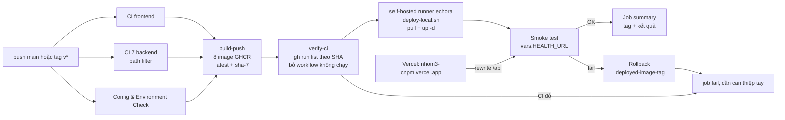

# CI/CD pipeline

1. Push lên `main` (hoặc tag `v*`) kích hoạt CD một lần cho mỗi ref, không chạy trên pull request.
2. CI chạy theo path filter cho từng service; workflow không được trigger cho SHA đó là bỏ qua, không phải lỗi.
3. `build-push` build 8 image và đẩy GHCR với hai tag: `latest` và `sha-<7>`.
4. `verify-ci` poll `gh run list` của đúng SHA, lấy attempt mới nhất mỗi workflow, fail nếu có workflow đã chạy mà không xanh.
5. Deploy chạy trên self-hosted runner `echora` của máy chủ, chỉ khi push `main`, qua environment `production`.
6. `deploy-local.sh` pull đúng tag `sha-<7>` rồi chạy Compose với `docker-compose.deploy.yml`, không build lại.
7. Smoke test gọi `vars.HEALTH_URL` (ngrok công khai) có retry; fail thì job fail.
8. Nếu health fail sau deploy, script rollback về tag trong `.deployed-image-tag` rồi thoát khác 0.
9. Frontend Vercel `https://nhom3-cnpm.vercel.app` rewrite `/api/*` sang backend ngrok.
10. Job summary ghi commit, image tag, deploy dir, health URL, kết quả smoke test và trạng thái job.
